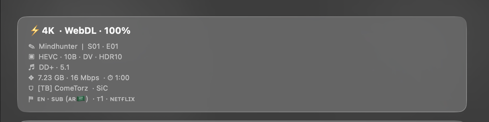
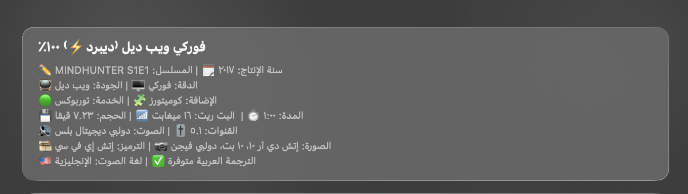
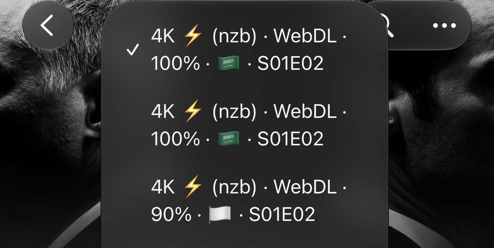
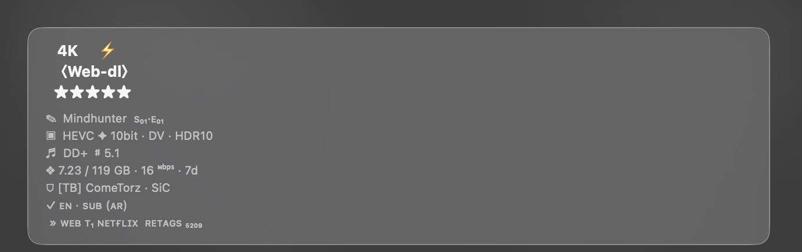

# Formatters

A collection of four AIOStreams formatters with JSON files and preview images.

1. [English](English.json)
2. [Arabic](Arabic.json)
3. [Jellyfin](Jellyfin.json)
4. [Tamtaro](Tamtaro.json)

## 1. English

[File: English.json](English.json)  
URL: [https://raw.githubusercontent.com/0-nj/Formatters/refs/heads/main/English.json](https://raw.githubusercontent.com/0-nj/Formatters/refs/heads/main/English.json)

## 2. Arabic

[File: Arabic.json](Arabic.json)  
URL: [https://raw.githubusercontent.com/0-nj/Formatters/refs/heads/main/Arabic.json](https://raw.githubusercontent.com/0-nj/Formatters/refs/heads/main/Arabic.json)

## 3. Jellyfin

[File: Jellyfin.json](Jellyfin.json)  
URL: [https://raw.githubusercontent.com/0-nj/Formatters/refs/heads/main/Jellyfin.json](https://raw.githubusercontent.com/0-nj/Formatters/refs/heads/main/Jellyfin.json)

## 4. Tamtaro

[File: Tamtaro.json](Tamtaro.json)  
URL: [https://raw.githubusercontent.com/0-nj/Formatters/refs/heads/main/Tamtaro.json](https://raw.githubusercontent.com/0-nj/Formatters/refs/heads/main/Tamtaro.json)

